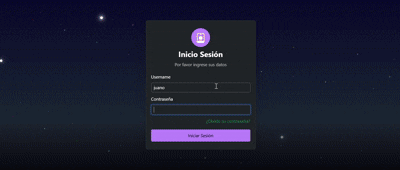

<p align="center">
  
</p>

# VeloPro Web


**VeloPro Web** es una aplicación web fullstack tipo ERP orientada a la gestión integral de negocios, permitiendo administrar inventario, ventas, tareas, usuarios y operaciones en tiempo real desde cualquier dispositivo.

Diseñada con un enfoque en escalabilidad, seguridad y eficiencia operativa.

---

## 📌 Descripción

VeloPro Web centraliza múltiples procesos críticos de un negocio en una sola aplicación, reduciendo la dependencia de herramientas externas y mejorando la trazabilidad de la información.

El sistema permite a los usuarios tomar decisiones informadas mediante datos actualizados, automatizando procesos clave y optimizando la gestión diaria.

---

## ⚙️ Características Principales

* **Sistema de Punto de Venta (POS interno):** Registro y control de ventas con múltiples métodos de pago (enfocado en gestión interna, no integración bancaria). Incluyendo gestión de préstamos.
* **Gestión de Inventario:** Control de stock en tiempo real con alertas automáticas.
* **Mensajería Interna:** Comunicación directa entre usuarios del sistema.
* **Gestión de Tareas:** Asignación, seguimiento y control de actividades.
* **Gestión de Despachos:** Registro y monitoreo de entregas a clientes.
* **Reportes Avanzados:** Visualización de datos mediante gráficos y exportación (PDF/Excel).
* **Historial de Transacciones:** Auditoría completa de operaciones.
* **Control de Usuarios:** Roles y permisos personalizados.

---

## 🛠️ Stack Técnico

### Backend

* Java 21
* Spring Boot 3
* Spring Security
* JWT (autenticación stateless)
* Spring Data JPA / JDBC
* MySQL
* Lombok
* Jakarta Validation
* Spring Mail
* iText (generación de PDFs)

### Frontend

* Angular 18
* TypeScript
* Bootstrap 5
* ApexCharts (gráficos)
* SweetAlert2 (UX interactiva)
* RxJS

### DevOps & Calidad

* GitHub Actions (CI/CD)
* SonarCloud (análisis estático)
* JaCoCo (cobertura de tests)
* Maven

---

## 🏗️ Arquitectura del Proyecto

El sistema sigue una arquitectura en capas (Layered Architecture), promoviendo una clara separación de responsabilidades:

1. **Controller Layer:** Manejo de endpoints y requests HTTP
2. **Service Layer:** Lógica de negocio
3. **Repository Layer:** Persistencia de datos
4. **Model Layer:** DTOs, entidades y enums

Aplicando buenas prácticas de:

* Clean Code
* Principios SOLID
* Diseño desacoplado y mantenible

---

## 📁 Estructura del Proyecto

```bash
veloProWeb/
│
├── backend-java/
│   ├── controller/        # Endpoints REST
│   ├── service/           # Lógica de negocio
│   ├── repository/        # Acceso a datos
│   ├── model/             # DTOs, Entities, Enums
│   ├── security/          # JWT y configuración de seguridad
│   ├── config/            # Configuraciones generales
│   ├── validation/        # Validaciones
│   └── util/              # Utilidades
│
├── frontend-angular/
│   ├── components/        # Componentes UI
│   ├── services/          # Consumo de API
│   ├── models/            # DTOs y modelos
│   ├── security/          # Manejo de auth
│   ├── utils/             # Helpers
│   └── validation/        # Validaciones
```
---

## 🔐 Seguridad

* Autenticación basada en JWT
* Control de acceso por roles
* Protección de endpoints con Spring Security
* Encriptación de contraseñas en backend
* Comunicación segura configurable mediante HTTPS

---

## 📸 Capturas del Sistema



---

## ⚡ Beneficios del Sistema

* Automatización de procesos críticos
* Reducción de errores manuales
* Acceso en tiempo real desde cualquier dispositivo
* Mejora en la toma de decisiones
* Escalabilidad según necesidades del negocio
* Trabajo colaborativo multiusuario

---

## 🛠️ Instalación y Ejecución

### Requisitos

* Java 21
* Node.js (>= 18)
* Angular CLI
* MySQL

---

### 🔙 Backend

```bash
cd backend-java
./mvnw spring-boot:run
```

O ejecutar directamente desde el IDE.

---

### 🔜 Frontend

```bash
cd frontend-angular
npm install
npm start
```

O:

```bash
ng serve -o
```

---

## 🔄 Integración Continua

El proyecto implementa:

* CI/CD mediante GitHub Actions
* Análisis de calidad con SonarCloud
* Cobertura de código con JaCoCo

---

## 📌 Estado del Proyecto

Proyecto funcional desarrollado como solución real para gestión de negocio.

---

## 👨‍💻 Autor

**Juan Ignacio Clavería** - *Full Stack Developer*

[](https://www.linkedin.com/in/juan-ignacio-claver%C3%ADa/)
[](https://juanin92.github.io/)

---

> 💡 **Nota para Reclutadores:**
> Este proyecto demuestra experiencia en desarrollo fullstack con arquitectura en capas, implementación de seguridad robusta con JWT, integración de herramientas DevOps (CI/CD, análisis de calidad), y construcción de soluciones reales orientadas a negocio con múltiples módulos integrados.
